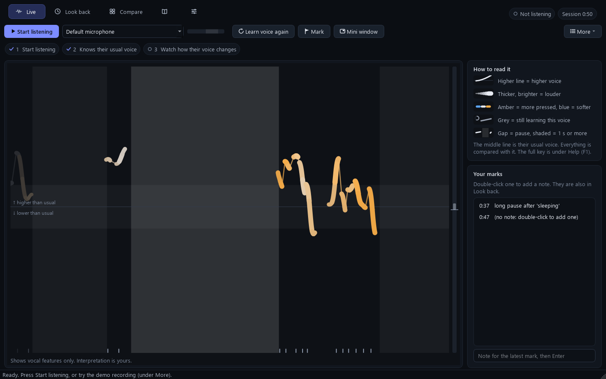
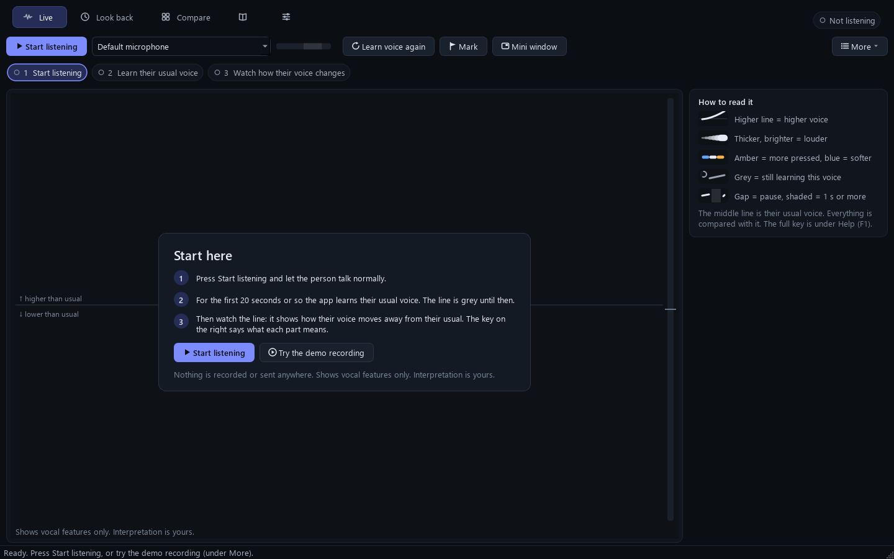
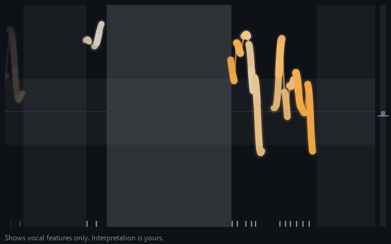
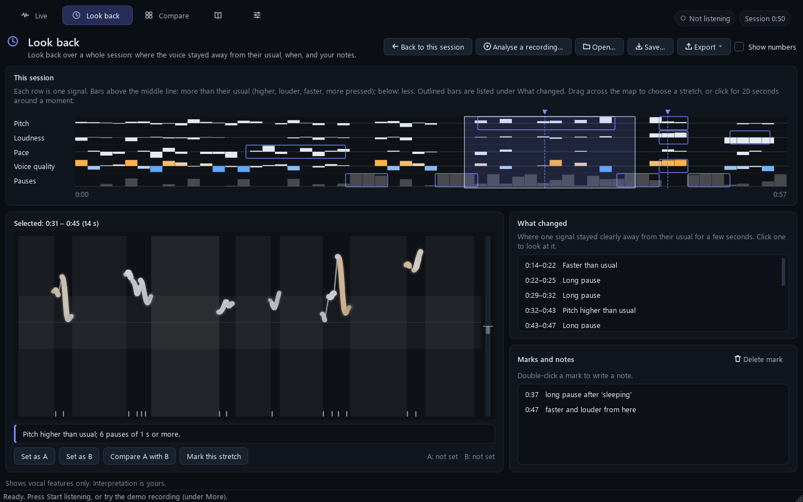
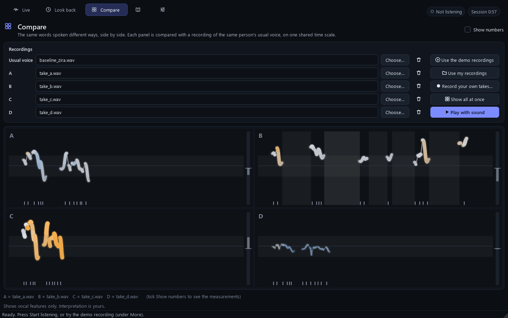
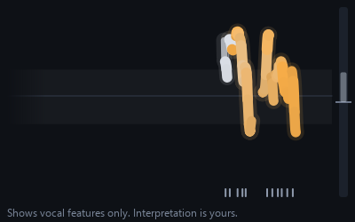
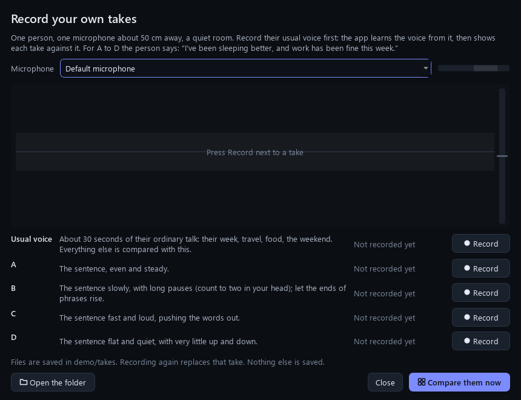
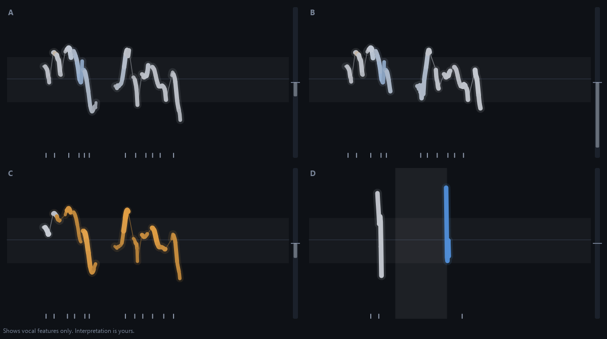

# Tone visualiser

An app that shows **how** someone is speaking, live:
- how high or low their voice is;
- how loud it is;
- where they pause, and for how long;
- how fast they talk;
- whether their voice sounds more pressed or more breathy than usual.

Everything is measured against **that person's own usual voice**.

It was built for Vikram, a deaf psychology student, to use alongside lip reading during supervised
role-play.

It shows **evidence, not a verdict**. It never labels emotions ("anxious", "angry"...) and never gives
scores. Working out what the voice means is left to the person watching. The app always says so:
*"Shows vocal features only. Interpretation is yours."*



*The Live tab part-way through the demo recording (a synthetic voice): long pauses (shaded), then
a fast, loud, pressed delivery (thick amber line, ticks packed together).*

---

## 1. Install (once per computer)

### Windows
1. Install **Python 3.12** from <https://www.python.org/downloads/>.
   On the first installer screen, tick **"Add python.exe to PATH"**.
2. Double-click **`setup.bat`** in this folder.
   It downloads about 140 MB (450 MB once unpacked) into a `.venv` folder here and takes a few minutes.
   Nothing is installed anywhere else on the computer.

### Mac (not tested yet, so please try this early)
1. Install **Python 3.12** from <https://www.python.org/downloads/>.
2. Open **Terminal**, type `cd ` (with a space), drag this folder into the Terminal window, press Return.
3. Type `bash setup.command` and press Return.
4. The first time you run the visualiser, macOS asks whether Terminal may use the microphone. Click **Allow**.

## 2. Run it

| To... | Windows | Mac (in Terminal, in this folder) |
|---|---|---|
| Open the app (the dashboard) | double-click **`run.bat`** | `bash run.command` |
| Only the small always-on-top window, on the microphone | `.\run.bat --corner` | `bash run.command --corner` |
| Play a recording through the small window | drag a `.wav` file onto **`play_file.bat`** | `bash run.command --file some.wav` |
| Show the four-way comparison on its own | double-click **`run_demo.bat`** | `bash run_demo.command` |

**First time?** Double-click `run.bat`, then press **Try the demo recording** in the middle of
the window. A synthetic voice talks normally for about 25 seconds (the app learns it), then says
one sentence four different ways. The key on the right explains the display, and **Help** (the
book icon, or F1) explains the rest.



## 3. The dashboard, tab by tab

### Live: watch a voice as it happens
One clean screen. Along the top: **Start listening**, the microphone, its level bar, then
**Learn voice again**, **Mark** and **Mini window**. Everything else is under **More**.

- **The three steps** under the buttons say what is happening: *1 Start listening*, *2 Learning
  their usual voice* (with how far it has got), *3 Watch how their voice changes*. The current step
  is outlined.
- **The big display** is described in section 4. While the app is still learning the voice, a
  banner on the display says so and fills up. Hover the mouse over any part of the display for a
  one-line explanation.
- **How to read it** (on the right) is a short key: the five things you need. The full key is in
  Help. Press **H** to hide it and give the display more room.
- **Learn voice again** makes the app learn a new speaker (section 5). **Mark** (or **M**) marks a
  moment to come back to; **N** marks it and lets you type a note. Your marks appear on the right
  once there is one.
- **Mini window** opens the small always-on-top window (below).
- **More** has: the demo recording, playing a sound file, new / save / open session, looking back
  at this session, pausing the picture (Space), the key on or off, and **Show each signal on its
  own row**, which adds the last minute of each signal on its own row and the whole session in
  one strip, under the display. That is off unless you choose it, because one display is easier
  to read.

### The mini window: for use during a session
The small always-on-top window, meant to sit in the corner of the screen and be read from the
corner of the eye while watching the client's face. It shows the same display as the Live tab.



Keys (click the window first): **Space** pause, **M** mark, **R** learn voice again, **T** always
on top on or off, **H** legend, **Esc** hide. Drag its edges to resize it; it stays readable down
to about 400 × 250 pixels.

### Look back: the whole session afterwards


- **The session map** shows the whole session, one row per signal. Bars above the middle line
  mean more than their usual (higher, louder, faster, more pressed); below means less.
- **What changed** lists the stretches where one signal stayed clearly away from their usual for
  a few seconds, in plain words about the voice ("Pitch higher than usual", "Long pause"). Click
  one to look at it.
- **Drag across the map** to choose any stretch. It is drawn below, with a sentence describing
  it. **Set as A** and **Set as B** on two stretches, then **Compare A with B**, shows them side
  by side with the differences in words.
- **Marks and notes**: double-click a mark to write or change its note.
- **Show numbers** adds the measurements to the words (for example "+3.0 semitones"). It is off
  unless you tick it. The live display never shows numbers.
- **Analyse a recording** looks back over a sound file without playing it (try
  `demo\wavs\session_demo.wav`). **Save** keeps the session as a `.tonevis` file (numbers only,
  never sound); **Open** brings one back. **Export** saves a text summary for supervision notes,
  or a picture of the page.

### Compare: the same words, spoken different ways
Up to four recordings side by side, each compared with a recording of the same person's usual
voice, on one shared time scale. **Use the demo recordings** fills in the synthetic takes;
**Play with sound** fills each panel in while it plays. See section 8 for recording your own.



### Help (the book icon)
Everything in this README's sections 4 to 9, inside the app, with pictures drawn by the app
itself: how to read each part of the display, a session from start to finish, a checklist for
reading a change, the keys, privacy, the limits, and the words used. **F1** opens it.

### Settings (the sliders icon)
Microphone and level check; how many seconds of speech it learns the usual voice from; saving,
loading or learning a usual voice from a recording; how many seconds the displays show; whether
the key, the signal rows and the numbers are shown; and the privacy options. Choices are
remembered between runs.

### Keys in the dashboard

| Key | What it does |
|---|---|
| **Space** | Pause the live picture; press again to go live |
| **M** | Mark this moment |
| **N** | Mark this moment and type a note (Enter saves it) |
| **H** | Show or hide the key beside the display |
| **F1** | Help |
| **F11** | Full screen (good for filming) |
| **Ctrl+1** to **Ctrl+5** | Go to a tab |
| **Ctrl+S** / **Ctrl+O** | Save / open a session |

## 4. What you see



Time runs **right to left**: the newest sound appears at the right edge and slides left. The live
view holds the last 15 seconds (the small window 10). Everything is compared with **this speaker's
own usual voice**, learned during calibration (section 5). So a naturally deep voice does not
look "low", and a naturally quiet person does not look "quiet".

| On screen | What it means |
|---|---|
| **Height of the line** | **Pitch.** Up = higher. Pitch is how fast the vocal folds are vibrating: faster vibration puts the line higher. It is measured from this speaker's own middle pitch. The top and bottom edges are 10 semitones (just under double or half the vibration speed) away from it. |
| **Dim line across the middle** | This speaker's usual middle pitch. |
| **Faint band around it** | This speaker's usual pitch range: 8 out of 10 moments of their normal speech fall inside it. The line leaving the band means unusually high or low for them. |
| **Thickness and brightness of the line** | **Loudness**, compared with their usual loudness. Thick and bright = louder; thin and dim = quieter. |
| **Colour of the line** | **Voice quality**, a stand-in for vocal tension. It shows how much of the voice's energy is in its higher frequencies, compared with their usual. When the vocal folds press together harder (effortful, strained speech), more energy goes into the higher frequencies: **amber**. When the voice is softer or breathier (air leaking past the vocal folds), less does: **blue**. **White** = as usual. |
| **Grey line, a ring and "calibrating…"** | Still learning this speaker. No colour and no pace bar until that is done. |
| **Thin dim line joining two strokes** | A consonant or tiny gap inside speech. Pitch only exists while the voice is buzzing (vowels, m, n, l...), not during s, t, k, f, p. |
| **A gap in the line** | A **pause**: silence of a quarter of a second or more. Its width is its length. |
| **Shaded column** | A pause of **1 second or more**. It gets darker at 2 s and again at 3 s. While a pause is happening, the column grows at the right edge. |
| **Ticks along the bottom** | One tick per **syllable**. Close together = talking fast; far apart or uneven = slow or halting. |
| **Bar on the right** | **Pace**: syllables per second while actually talking (pauses are not counted), compared with their usual pace, which is the notch in the middle. The bar grows **up = faster** than usual, **down = slower**. It fades while they are pausing. |
| **Dot at the right end of the line** | Their voice, right now. |
| **Faint dashes along the very top or bottom edge** | The measured pitch went past the edge of the scale. Usually this is a measuring mistake (section 9), now and then a real extreme (a shout, a squeak). |

**Learning it without a memory of sound.** Every mapping is "more = up, thicker, brighter or further
from white":
- higher pitch goes up;
- louder is thicker and brighter;
- faster pushes the bar up;
- a longer silence is a wider, darker column.

Useful patterns, not rules:
- In English, statements often end with the line falling, and many questions or uncertain statements
  end with it rising. Other languages have their own patterns.
- A line that hugs the middle is a flat voice.
- Big, frequent movements are a lively voice.

What any of it *means* for this person, right now, is your judgement.

## 5. Calibration

When listening starts, the line is **grey** and a small ring fills up next to "calibrating…". The
label at the top right says "Learning this voice" with a percentage.
- The app needs about **15 seconds of the person actually speaking**. Pauses do not count, so this is
  usually 20 to 25 seconds of conversation.
- From that it learns their middle pitch, usual range, loudness, pace and voice quality.
- The line then turns white, and colour and the pace bar appear.

The baseline then **stays fixed**, so that slow changes across a session (someone getting steadily
quieter, say) stay visible.
- **It learns whoever speaks first.** In a role-play, press **Learn voice again** (R in the mini window)
  as soon as the client starts talking.
- In **Settings** you can save their usual voice and load it next time, so a later session with the same
  person starts already calibrated, or learn the baseline from a recording of them talking
  normally. From the command line: `.\run.bat --baseline their_normal_voice.wav`.

## 6. Marks, notes and saving a session

- **M** drops a mark at this moment; **N** drops one and lets you type a note at once. Marks show
  as dashed lines on the signal rows and the maps.
- In **Look back**, double-click a mark to change its note, or **Mark this stretch** to mark a
  selected stretch.
- **Save** keeps the whole session as a `.tonevis` file: the measurements, marks, notes and the
  baseline. **It contains no sound.** **Open** brings it back into Look back.
- **Export → Summary as text** writes a plain summary for supervision notes: the baseline, the
  whole session in words, what changed and when, and each mark with a description of the voice
  around it.
- Closing the app with an unsaved session asks whether to save it.

## 7. Privacy

* Everything runs on this computer. After setup it needs no internet, and it sends nothing anywhere.
* Sound is **never saved** unless you ask for it: the box in Settings, `--record`, or recording takes
  on purpose (section 8).
* Measurements stay in memory until you save a session, and a saved session holds numbers only.
* Your display choices (microphone, what is shown, window size) are remembered in `settings.ini`
  in this folder. It holds no sound and no measurements; delete it to go back to the defaults.

## 8. The demo comparison, and recording your own takes

The **Compare** tab (and `run_demo.bat`) shows the same sentence delivered four ways, side by
side, all measured against one baseline recording of the same speaker.
- Panels are labelled A to D only. The app never shows words like "calm".
- The recordings that come with it are **synthetic**: Windows' built-in voice, edited on purpose
  to be slower, faster, louder, flatter and so on. They are good for testing, but sound robotic.
  Record real people for the video.

**To record your own takes**, open the Compare tab and press **Record your own takes…**:



1. Choose the microphone. Speak: the level bar should reach the lighter zone.
2. Press **Record** next to **Baseline**; the person talks normally for about 30 seconds; press
   **Stop**. The app learns their voice from it.
3. Record **A** to **D**: the same sentence each time, delivered the way the row describes. While
   recording, the display shows the take against the baseline, so you can see at once whether it
   came out as planned. Record a take again to replace it.
4. Press **Compare them now**.

The recordings are saved in `demo\takes` (`baseline.wav`, `a.wav` ... `d.wav`), where the
Compare tab's **Use my recordings** and `run_demo.bat` find them. What to say, and how to film it,
is in [demo/DEMO_SCRIPT.md](demo/DEMO_SCRIPT.md).

From a terminal instead (in this folder: right-click an empty part of the folder, **Open in
Terminal**): `.\run.bat --corner --record demo\takes\a.wav` records while the small window shows
the voice; press **Q** to stop.

## 9. When it gets things wrong

These are known weak spots. The display shows the failure; it does not hide it. The pictures below
show the clean sentence (A) next to three failures (B to D):



* **Two people talking at once (B):**
  - After calibration the line mostly stays on the calibrated voice, if the other voice is much
    higher or lower.
  - But loudness and pace mix both voices. Pace read 0.69 × usual here, which is wrong.
  - Before calibration, the line jumps between the two voices.
* **A voice coming out of a small speaker (C)**, such as a video call on laptop speakers picked up
  by the microphone:
  - Pitch is still right.
  - But small speakers cut the low frequencies, so the whole line turns **amber** (it looks "pressed")
    when it isn't.
  - Calibrate through the same sound path you will actually use.
* **Whispering (D)** has no pitch, so there is mostly no line. The tracker still produced two stray
  strokes.
* **Creaky voice**, the low rattle many people drop into at the end of a sentence, makes the line drop
  out or jump.
* **Very fast speech:** syllables run together and some are not counted. A delivery about 1.4 × faster
  showed as only 1.14 × on the pace bar. The bar still goes the right way, just not far enough.
* **Everyone in the room is heard**, including Vikram himself if he speaks. The display shows whoever
  is talking.
* **Background voices, a TV or music** add extra strokes. Quiet, steady mains hum is ignored. A quiet
  room helps a lot.
* **Laptop built-in "Microphone Array" devices** clean up the sound themselves: they mute the
  background between sounds and even out loudness. A plug-in or USB microphone is better.
* **Video calls:** the app hears the call only through a microphone near the speakers, with the
  problems above. Windows can pass the call audio in directly through a device called "Stereo Mix",
  but it is switched off on most laptops (it was on the development laptop). To try it:
  1. In Windows' Sound settings, open More sound settings, then the Recording tab.
  2. Right-click, choose Show disabled devices, then enable Stereo Mix.
  3. Choose Stereo Mix as the microphone in the app.

  This is untested.

## 10. Troubleshooting

| Problem | Try this |
|---|---|
| "Please double-click setup.bat first" | Run `setup.bat` once (section 1). |
| Nothing appears when someone speaks | Check the microphone chosen next to **Start listening**, and that the level bar moves when someone talks. In Settings, press **Refresh** after plugging a microphone in. |
| It stays on "Learning this voice" | It needs about 15 s of *voice*. It ignores noise without voice, such as fans or typing. Keep talking, a little closer to the microphone. |
| "No sound from the microphone" | The microphone may be muted, or Windows may be blocking it: go to Settings > Privacy & security > Microphone and turn on "Let desktop apps access your microphone". On a Mac: System Settings > Privacy & Security > Microphone > allow Terminal. |
| "The microphone stopped sending sound" | Another app (a call or voice-changer app) may have taken over the microphone, or it was unplugged. Press Stop, then Start listening again. |
| The line jumps around a lot, or looks amber for no reason | See section 9. Usually it is background sound, or sound coming from speakers. |
| The window is too big for the screen | Press F11 for full screen, or use the mini window. The dashboard needs at least 1140 × 700. |
| Everything looks too small on video | Make the window bigger, or press F11. The mini window can be dragged bigger too. |

## 11. Command-line options

Type these after `.\run.bat` in a terminal (section 8), for example `.\run.bat --device 15 --debug`.
On a Mac, put them after `bash run.command`.

| Option | What it does |
|---|---|
| `--corner` | Just the small always-on-top window on the microphone, no dashboard |
| `--listen` | Dashboard: start listening straight away |
| `--file X.wav` | Play a recording through the small window (and out of the speakers) instead of using the microphone |
| `--compare A.wav B.wav ...` | Show up to four recordings side by side (the first is the baseline unless you give `--baseline`) |
| `--baseline X.wav` | Measure against a baseline taken from this recording, instead of calibrating live |
| `--calibrate S` | Seconds of speech the live calibration uses (default 15) |
| `--mute` | With `--file`: analyse at normal speed without playing the sound. With `--compare`: show everything at once, silently |
| `--list-devices` | List the microphones |
| `--device N` or `--device "name"` | Use a particular microphone |
| `--record [X.wav]` | Save what the microphone hears. With a file name: the first time you press Start listening (or, with `--corner`, straight away). Without one: every time you listen, into the `recordings` folder |
| `--seconds S` | How many seconds the live display shows |
| `--debug` | Print the measured delay every 2 seconds |
| `--snapshot X.png` | Save a picture of the window when it closes (with `--file` or `--compare`: when the playing ends) |
| `--quit-after S` | Close automatically after S seconds |

## 12. Delay (latency)

The app measures, for every 10 ms of sound, how long it takes from reaching the microphone to
appearing on screen. The dashboard shows the median at the bottom right while listening; `--debug`
also prints the 95th percentile every 2 seconds.

Measured on the development laptop (Windows 11):
- The small window: **about 72 ms median, 85 ms 95th percentile** while calibrating, and **about
  64 ms median** afterwards.
- The dashboard: **69 ms median, 94 ms 95th percentile** from the sound being handed over by the
  sound card to it being drawn (measured with a recording standing in for the microphone; the
  microphone's own 20 ms buffer comes on top).
- The target was under 300 ms. The screen itself adds another frame or two (about 17 to 33 ms),
  which software cannot measure. When playing a file, the line trails the sound you hear by only
  about 10 ms.

## 13. For developers

```
tonevis/
  __main__.py   command line (python -m tonevis)
  audio.py      microphone and file sources, 16 kHz resampler, recording writer
  tracker.py    pitch, level and spectral balance for every 10 ms; the analysis thread
  prosody.py    loudness, pauses, syllables and pace, tension, calibration flow
  baseline.py   the speaker baseline and the calibrated pitch range
  features.py   pure signal functions (Praat pitch, level, spectral tilt)
  session.py    a whole session's measurements: summaries in words, what changed, .tonevis files
  engine.py     runs one listening session at a time and feeds the session
  config.py     every threshold and mapping in one place; this README mirrors it
  display.py    all drawing of the display (QPainter): the live view, the small window, comparisons
  dashboard.py  the dashboard window and its five tabs
  theme.py      the dashboard's colours, style, drawn icons and building blocks
  guide.py      the key beside the live view and the How it works page (pictures drawn by display.py)
  takes.py      the "Record your own takes" window
demo/           the test recordings, make_test_wavs.py, run_demo.py, DEMO_SCRIPT.md
tools/          tension_bakeoff.py (why spectral tilt), voice_effects.py (test-material edits),
                dashboard_screenshots.py (remakes the dashboard pictures in docs/img),
                record_clips.py and make_cards.py (the video's screen clips and cards;
                make_video_bits.bat runs both)
video/          SHOOT_SHEET.md (who films what), the cards, the caption files; clips/ is made
                by make_video_bits.bat and not kept in git
tests/          pytest tests on synthetic signals, including pixel checks of every mapping
docs/img/       pictures used in this README
BUILD_LOG.md    dated design decisions, for the design portfolio
```

Run the tests with `.venv\Scripts\python.exe -m pytest` (Mac: `.venv/bin/python -m pytest`).
122 tests, including one that checks no string in the app names a feeling.
